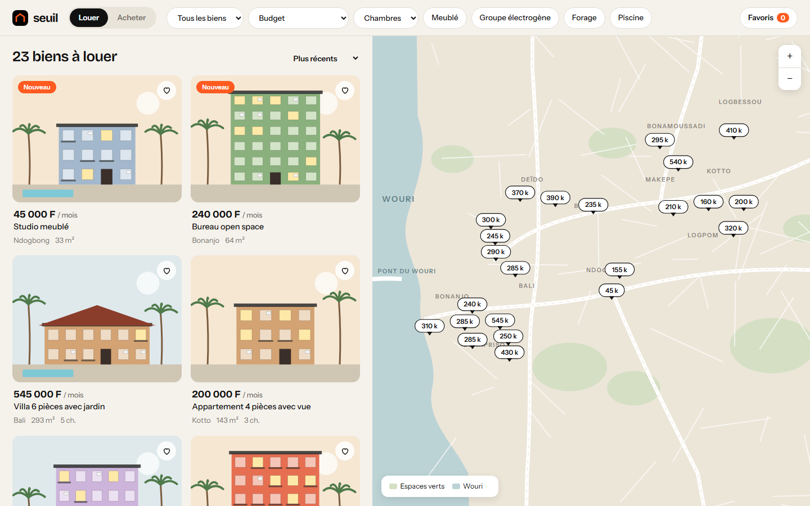
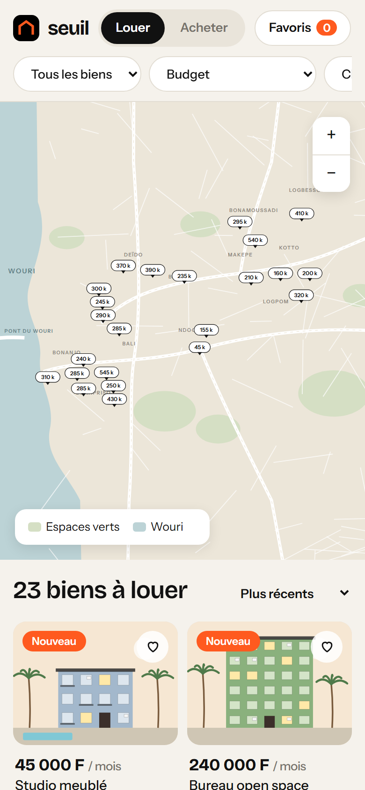

# Seuil Immobilier

**Plateforme d'annonces immobilières avec carte** — Portail immobilier pour Douala : liste et carte synchronisées, filtres instantanés, fiche détaillée avec plan, simulateur de crédit ou de budget d'entrée, favoris et demande de visite.

**Démo en ligne : [https://lordlennyx.github.io/seuil-immobilier/](https://lordlennyx.github.io/seuil-immobilier/)**

Spot de présentation (30 s) : [media/spot-30s.mp4](https://lordlennyx.github.io/seuil-immobilier/media/spot-30s.mp4)

## Ce que le projet montre

- Carte vectorielle stylisée de Douala (Wouri, quartiers, axes) avec étiquettes de prix, zoom, déplacement et « rechercher dans cette zone »
- Survol croisé liste ↔ carte, tri par prix ou prix au m², filtres location / vente, type, budget, chambres, équipements
- Façades illustrées et plans indicatifs générés pour chaque bien (aucune photo de banque d'images)
- Simulateur de crédit (apport, durée, taux, coût des intérêts) et budget d'entrée en location (caution, avance, frais d'agence)
- Favoris conservés sur l'appareil, demande de visite avec choix du créneau, conseiller attitré

## Réalisation

- **Stack :** HTML, CSS, JavaScript natif, SVG
- **Typographies :** Bricolage Grotesque, Instrument Sans
- **Évolutions possibles :** back-office agence, vraies photos, carte OpenStreetMap / Mapbox, alertes WhatsApp, paiement de caution en ligne

| Bureau | Mobile |
|---|---|
|  |  |

---

Client et contenus fictifs, créés pour la démonstration. Conception, design et développement : **Njundiyimun Béchard** — [github.com/LordLennyx](https://github.com/LordLennyx)
